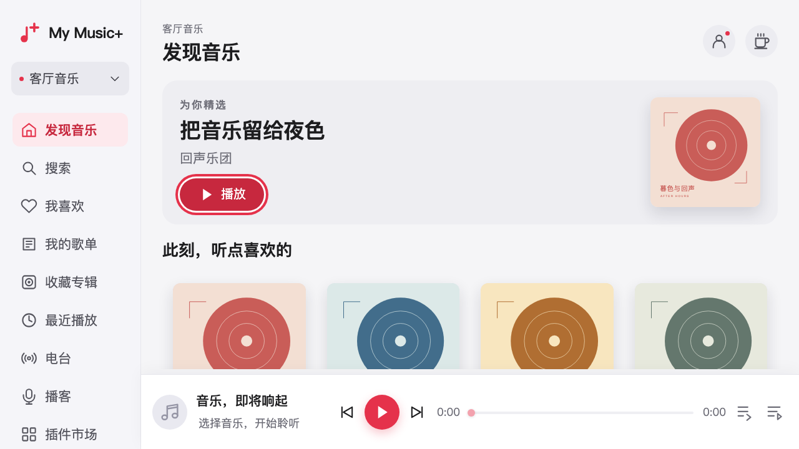
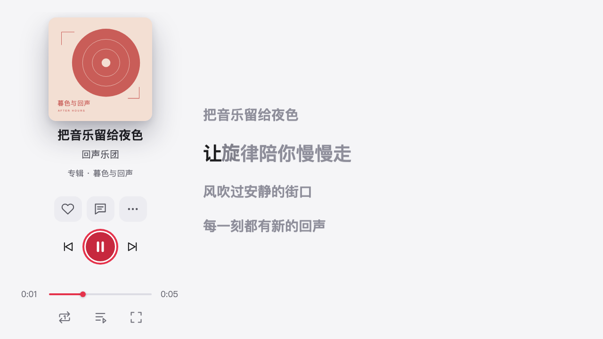
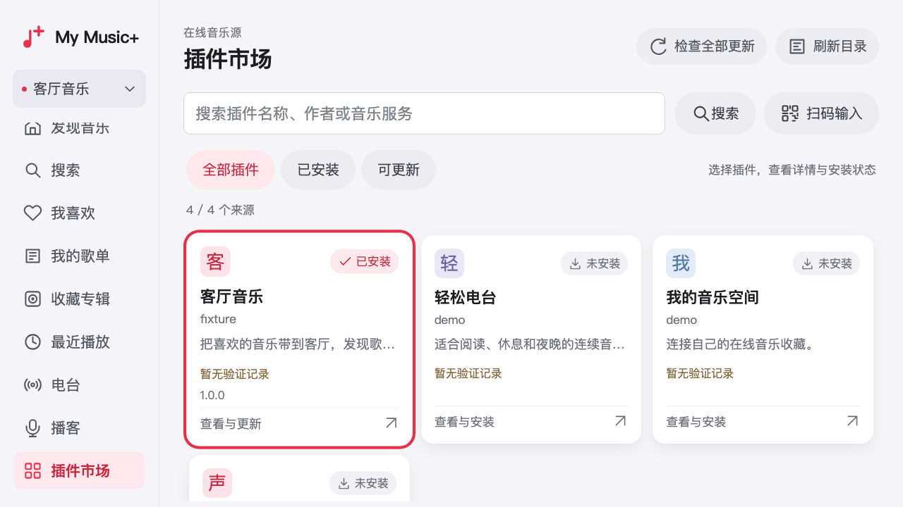

  

<h1 align="center">My Music+</h1>

把喜欢的音乐，带到电视大屏。

  <a href="https://github.com/aston314/my-music-release/releases/latest">下载 Android 版</a> ·
  <a href="https://github.com/aston314/my-music-release/releases">查看版本记录</a>

My Music+ 是一款为电视大屏打造的在线音乐播放器。通过插件选择喜欢的音乐源，用遥控器发现歌单、搜索歌曲、查看歌词，让客厅里的音乐更自在。

## 先看一眼

**[▶ 观看完整演示](https://aston314.github.io/my-music-release/)**

发现音乐 → 浏览歌单 → 搜索 → 同步歌词与全屏歌词 → 插件市场 → 外观切换。

演示使用示例内容，展示当前界面；实际体验以安装版本和所选音乐源为准。

## 按自己的方式听音乐

| 想做什么 | My Music+ 能帮你做什么 |
| --- | --- |
| 选择音乐源 | 在插件市场浏览、搜索、安装和更新插件，已安装的插件一眼可辨。 |
| 找到喜欢的歌 | 搜索歌曲、歌手、专辑和歌单；也可以用手机扫码输入搜索内容。 |
| 接着探索 | 从正在播放的歌曲进入歌手、专辑和歌曲列表，让发现音乐的过程连贯起来。 |
| 跟着歌词听 | 同步显示歌词；音乐源提供逐字时间时，文字随演唱逐字高亮，也支持全屏欣赏。 |
| 留住喜欢的音乐 | 喜欢歌曲、收藏专辑、管理歌单，查看歌曲评论。 |
| 掌握播放节奏 | 查看播放队列，切换顺序、列表循环、单曲循环或随机播放，直接调整播放进度。 |
| 换一种氛围 | 淡色、深色主题随心切换，支持简体中文与繁体中文，侧栏也可只显示图标。 |
| 轻松用遥控器 | 面向大屏的清晰排版和焦点提示，在页面、列表、弹窗之间顺畅移动。 |

不同音乐源提供的内容、登录方式和可用功能有所不同；部分内容需要对应平台的账号或会员权限。

## 大屏上的聆听时刻

| 歌词跟着音乐走 | 音乐源，由你选择 |
| --- | --- |
|  |  |

## 下载与更新

从 **[最新版本](https://github.com/aston314/my-music-release/releases/latest)** 下载 APK，在 Android 电视或电视盒子上安装。

已安装的用户可以前往 **设置 → 版本更新 → 检查更新**。覆盖安装可保留现有账号、音乐源和偏好设置。

## 致谢 MyGo Music

向 **[MyGo Music](https://github.com/egoist/mygo-music)** 致敬，感谢 **[EGOIST](https://github.com/egoist)** 及贡献者带来的优秀音乐播放器，以及围绕插件、在线音乐源和歌词体验的解决方案。My Music+ 在这些成果的基础上，继续探索适合电视大屏的聆听体验。

也感谢每一位插件作者、测试者和使用者。
